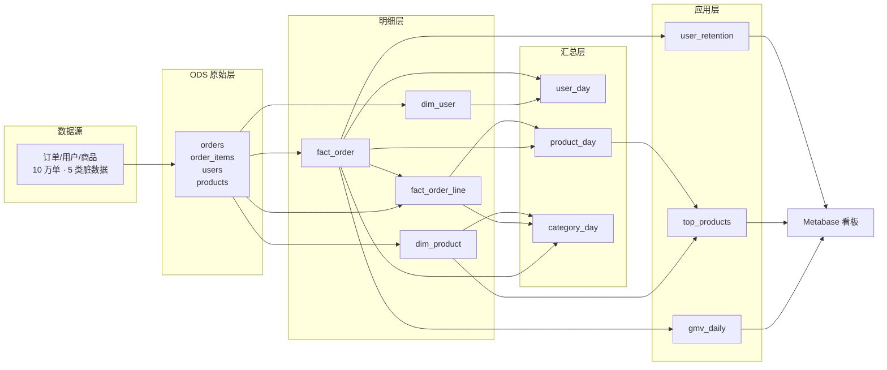

# 电商数据平台（离线数仓 Demo）

一个从**脏数据**到**BI 看板**的完整离线数仓项目：四层建模、数据质量校验、任务编排、
指标口径管理，全链路可一键重建。

> 目标不是「跑通一个 demo」，而是把数据工程里**容易被忽略的部分**做出来：
> 脏数据怎么处理、口径怎么定义、链路怎么保证幂等、质量怎么验证。

---

## 架构



**四层职责**

| 层 | 职责 | 典型问题 |
|---|---|---|
| **ODS** | 原样保存上游数据，允许脏 | 重复、空值、越界值都在这里 |
| **DWD** | 清洗、去重、补维度，建主键 | 这一层开始，数据是可信的 |
| **DWS** | 按维度预聚合，指标可复用 | 口径在这里固化 |
| **ADS** | 面向具体报表，一表一用 | 看板直接读这层 |

---

## 核心数据

| 项 | 值 |
|---|---|
| 订单量 | 10 万（注入脏数据后 100,300 行） |
| 清洗后订单 | 98,200（丢弃 1,800 + 去重 300） |
| 商品明细 | 293,996 行 |
| 总 GMV | 10.91 亿元（90 天） |
| 表数量 | 14 张（ods 4 / dwd 4 / dws 3 / ads 3） |

---

## 快速开始

前置：Docker、Python 3.10+、MySQL 客户端。

```powershell
# 1. 起基础设施（MySQL + Metabase）
docker compose up -d

# 2. 装依赖
python -m pip install -r requirements.txt

# 3. 一键跑完整条链路（造数 → 清洗 → 汇总 → 应用 → 质量校验）
python scripts/run_pipeline.py
```

完成后再跑一次验证幂等：

```powershell
python scripts/run_pipeline.py --skip-gen    # 跳过造数，只重跑 ETL
```

**看板**：浏览器打开 `http://localhost:3000`（Metabase，首次需配置数据库连接：
Host `mysql`、Port `3306`、库 `ads`）。

---

## 项目结构

```
data-platform/
├── docker-compose.yml        # MySQL + Metabase
├── requirements.txt
├── etl/
│   └── gen_data.py           # 造数：帕累托分布 + 5 类脏数据注入
├── sql/
│   ├── init/                 # 建库脚本（容器首次启动执行）
│   ├── ods/                  # 原始层建表
│   ├── dwd/                  # 明细层清洗
│   ├── dws/                  # 汇总层聚合
│   └── ads/                  # 应用层指标
├── quality/
│   ├── rules.yaml            # 质量规则（配置化，8 种规则类型）
│   └── check.py              # 规则执行器 + HTML 报告
├── scripts/
│   ├── run_pipeline.py       # 编排：DAG 拓扑排序 + 失败即停 + 耗时统计
│   └── run_sql.ps1           # 单文件 SQL 执行工具
└── docs/
    ├── metrics.md            # 指标口径字典
    ├── data-dictionary.md    # 表 / 字段说明
    ├── dirty-data.md         # 脏数据注入与对账
    ├── performance.md        # 性能分析与优化记录
    ├── lineage.md            # 血缘图（自动生成）
    └── quality-report.html   # 质量报告（自动生成）
```

---

## 指标口径

**完整定义见 [`docs/metrics.md`](docs/metrics.md)**，这里只列核心几条：

| 指标 | 口径摘要 |
|---|---|
| GMV | 当天支付成功的订单金额，按**支付日期**归属，不含取消/退款 |
| 客单价 | GMV ÷ 支付订单数（不是用户数） |
| D7 留存率 | 首购后第 7 天回访用户 ÷ 该首购日 cohort 用户，剔除观察期不足的 cohort |
| Top 商品 | **分品类**排名，全局榜会被高单价品类垄断 |

> 口径约定：**同一指标只在一处定义**，报表与文档不一致时以文档为准。

---

## 数据质量

| 脏数据类型 | 注入 | 规则抓到 | 结果 |
|---|---|---|---|
| 用户为空 | 1,000 | 1,000 | ✅ |
| 金额为负 | 500 | 500 | ✅ |
| 订单号重复 | 300 | 300 | ✅ |
| 状态越界 | 200 | 200 | ✅ |
| 时间穿越 | 100 | 100 | ✅ |

**五条规则全部精确匹配**，详见 [`docs/dirty-data.md`](docs/dirty-data.md)。

规则配置化（`quality/rules.yaml`），支持 9 种规则类型：非空、值域、唯一、枚举、时序、
金额一致、引用完整、环比波动、**完整性（表行数）**。报告输出 HTML（含健康分）。

---

## 工程实践

| 实践 | 说明 |
|---|---|
| **幂等** | 每个 ETL 都是 `TRUNCATE + INSERT`，重跑结果一致 |
| **DAG 编排** | 用依赖声明 + 拓扑排序决定执行顺序，启动时检测循环依赖 |
| **失败即停** | 任一任务失败立即中断，已完成任务不回滚，报错精确到「第几条语句」 |
| **守恒校验** | 每层都校验「明细合计 = 汇总合计」，任何一层丢数据都会被发现 |
| **配置化规则** | 改质量规则不用改代码 |
| **血缘自动解析** | 用 sqlglot 解析 SQL 依赖生成 Mermaid 图，并校验「SQL 实际依赖」与「DAG 声明」是否一致 |

---

## 已知限制

诚实地列出来，比假装完美更有用：

1. **模拟数据特征**：留存曲线受 cohort 组成偏差影响；无退款、运费、优惠券字段。
2. **无增量调度**：目前是全量重建。数据量到百万级以上需要改增量 + 按天重跑。
3. **无告警**：质量校验失败只返回非 0 退出码，没有对接邮件/IM 通知。
4. **城市未标准化**：`哈尔滨市 / 哈尔滨县` 这类同地异名未做映射，会拆散分组统计。
5. **维度表未做 SCD**：`dim_user` / `dim_product` 只保留最新版本，无法追溯历史价格、
   历史城市。需要缓慢变化维（SCD2）时得改造。

---

## 技术栈

| 组件 | 用途 |
|---|---|
| MySQL 8.4 | 数据存储（四层 schema 隔离） |
| Python 3.12 | 造数、质量校验、编排 |
| pymysql / PyYAML | 数据库驱动、规则配置 |
| Metabase | BI 看板 |
| Docker Compose | 环境编排 |

---

## 后续规划

- [x] 补 `dwd.dim_product`，消除分层违规
- [x] 慢查询分析：`EXPLAIN ANALYZE` 定位到写入瓶颈，量化后决定不优化（见 [`docs/performance.md`](docs/performance.md)）
- [ ] Metabase 看板导出截图，放进 README
- [ ] 血缘自动解析（sqlglot → Mermaid）
- [ ] 接入调度（Airflow / DolphinScheduler），支持按天重跑
- [ ] 维度表支持 SCD2，保留历史版本
