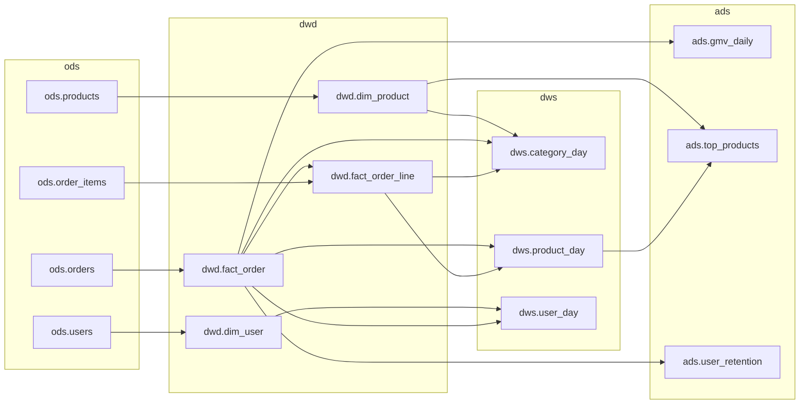

# 数据血缘图

> 自动生成，请勿手工编辑。脚本：`lineage/build_lineage.py`，引擎：**sqlglot**

## 血缘图

## 表级依赖明细

| 表 | 上游（数据来自） | 下游（被谁使用） |
|---|---|---|
| `ads.gmv_daily` | dwd.fact_order | — |
| `ads.top_products` | dwd.dim_product, dws.product_day | — |
| `ads.user_retention` | dwd.fact_order | — |
| `dwd.dim_product` | ods.products | ads.top_products, dws.category_day |
| `dwd.dim_user` | ods.users | dws.user_day |
| `dwd.fact_order` | ods.orders | ads.gmv_daily, ads.user_retention, dwd.fact_order_line, dws.category_day, dws.product_day, dws.user_day |
| `dwd.fact_order_line` | dwd.fact_order, ods.order_items | dws.category_day, dws.product_day |
| `dws.category_day` | dwd.dim_product, dwd.fact_order, dwd.fact_order_line | — |
| `dws.product_day` | dwd.fact_order, dwd.fact_order_line | ads.top_products |
| `dws.user_day` | dwd.dim_user, dwd.fact_order | — |
| `ods.order_items` | — | dwd.fact_order_line |
| `ods.orders` | — | dwd.fact_order |
| `ods.products` | — | dwd.dim_product |
| `ods.users` | — | dwd.dim_user |

## 与 DAG 声明的一致性检查

全部一致：每个任务的 SQL 依赖，都在 `deps` 里声明了。

> 检查原理：解析每个任务的 SQL 实际读了哪些表 → 找到产出这些表的任务 →
> 比对 `run_pipeline.py` 里的 `deps`。缺失说明「SQL 改了但 DAG 没改」，会导致乱序执行。
